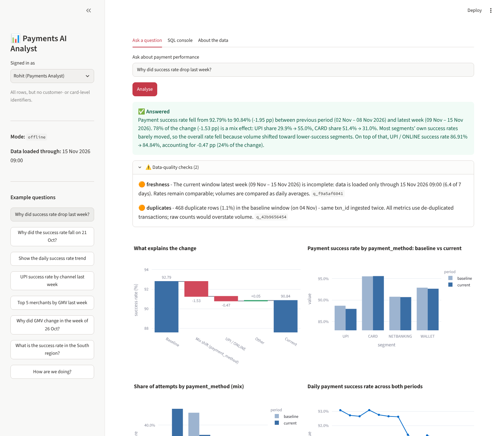
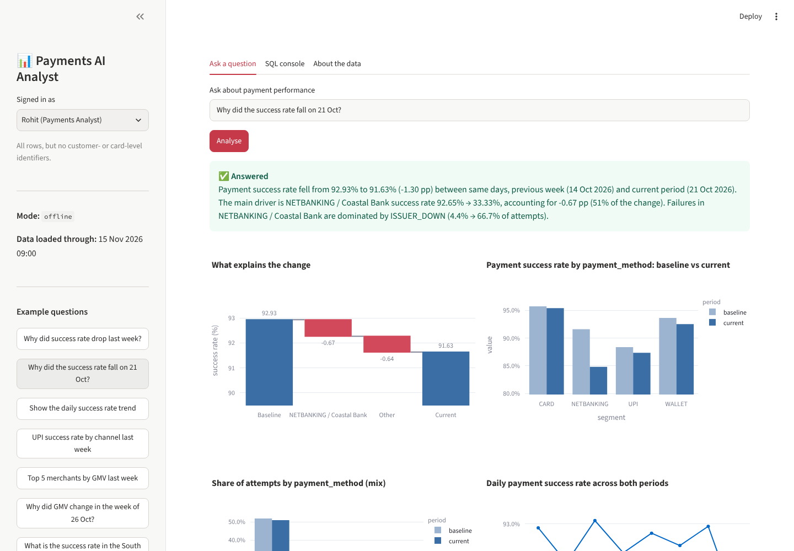
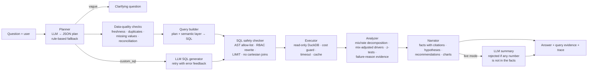

# Payments AI Business Analyst

[](https://github.com/Rahulm-027/payments-ai-analyst/actions/workflows/ci.yml)

Ask a question about payment performance in plain English, such as *"Why did success rate drop last week?"*. You get back an answer with evidence: the SQL that was run, a breakdown of what drove the change, charts, data-quality warnings, and a clear split between **observed facts**, **hypotheses** and **recommendations**.



---

## Contents
1. [What it does](#what-it-does)
2. [Quickstart](#quickstart)
3. [Architecture](#architecture)
4. [Key design decisions](#key-design-decisions)
5. [Data and planted scenarios](#data-and-planted-scenarios)
6. [Safety and access control](#safety-and-access-control)
7. [How each failure scenario is handled](#how-each-failure-scenario-is-handled)
8. [Evaluation](#evaluation)
9. [Testing](#testing)
10. [API](#api)
11. [Project structure](#project-structure)
12. [Assumptions, mocked dependencies and limitations](#assumptions-mocked-dependencies-and-limitations)
13. [What I would do next](#what-i-would-do-next)

---

## What it does

| You ask | You get |
|---|---|
| **Why did success rate drop last week?** | Success rate fell from 92.79% to 90.84% (−1.95 pp). **78% of that is a mix effect**: UPI's share of transactions rose from 29.9% to 55.0%, and UPI succeeds less often than cards, while per-method rates were flat. **On top of that**, UPI on the online channel had a real decline (86.91% → 84.84%, p = 0.0007), worth −0.47 pp. It also warns that the latest week is only partly loaded and that the comparison week contains duplicate rows. |
| **Why did the success rate fall on 21 Oct?** | The main driver is **Coastal Bank netbanking**: 92.65% → 33.33%. Failures there are dominated by **ISSUER_DOWN** (4.4% → 66.7% of attempts), pointing to a bank-side outage (high confidence). Recommended actions: raise an incident with the bank, add fallback routing, and alert on issuer-level success rate. |
| **What is the success rate in the South region?** *(as Neha, North-region manager)* | 🔒 *You can only view region = North data, but the question asks about South.* |
| **How are we doing?** | A clarifying question ("which metric?") with suggested rephrasings. |
| `DROP TABLE transactions` *(in the SQL console)* | 🛑 Blocked by the safety checker. |

It also handles trends ("daily success rate trend"), breakdowns ("UPI success rate by channel", "top 5 merchants by GMV"), single figures ("GMV in the week of 26 Oct", which also flags a settlement mismatch) and failure-reason analysis ("failure rate by error code yesterday").



---

## Quickstart

**Docker (recommended).** No API key needed; it runs in deterministic offline mode.

```bash
git clone https://github.com/Rahulm-027/payments-ai-analyst.git
cd payments-ai-analyst
docker compose up --build
```
- UI: http://localhost:8501
- API docs: http://localhost:8000/docs

**Local Python (3.11+)**

```bash
pip install -e ".[dev]"
make data       # builds data/payments.duckdb (~350K rows, ~4 s, seeded)
make test       # 99 tests
make eval       # golden-question evaluation -> eval/results.md
make run-ui     # Streamlit on :8501
make run-api    # FastAPI on :8000
```

**Live LLM mode (optional).** Copy `.env.example` to `.env` and set:
```
LLM_MODE=live
GROQ_API_KEY=<your key>
```
In live mode the LLM plans questions, writes free-form SQL for questions the standard analyses can't express, and rewrites the executive summary. Every one of those outputs is validated, and the system falls back to offline behaviour if the model fails (see [design decisions](#key-design-decisions)).

---

## Architecture



| Stage | File | What it does |
|---|---|---|
| Semantic layer | `config/metrics.yaml` | One definition for each metric (e.g. success rate excludes `USER_CANCELLED`) and dimension. The LLM picks from these; it never invents formulas. |
| Planner | `stages/planner.py`, `llm/rules.py` | Turns the question into a typed `Plan`: intent, metric, dimensions, filters, current/baseline windows, assumptions. Plans from the LLM are checked against the semantic layer and the list of real dimension values. |
| Data quality | `stages/quality.py` | Runs before every analysis and turns problems into explicit warnings. It only blocks the answer when there is no data at all. |
| Query builder | `stages/query_builder.py` | Builds standard-analysis SQL deterministically from the plan. |
| Safety checker | `stages/validator.py`, `security/rbac.py` | Parses every query (from a template, the LLM or a person) and rejects anything that isn't a safe read. It also rewrites the query to apply the user's access scope. |
| Executor | `stages/executor.py` | Read-only DuckDB connection with file and network access turned off, a pre-run check of the query plan's size, a timeout, a row cap and an LRU cache. |
| Analyzer | `stages/analyzer.py` | Pure Python, no LLM. Splits a change into mix and rate effects, finds mix-adjusted rate drivers with significance tests, and flags trend anomalies. |
| Narrator | `stages/narrator.py` | Writes facts (each citing a query id, dataset, window and filters), hypotheses with confidence levels, recommendations, caveats and chart specs. |
| Pipeline | `core/pipeline.py` | Orchestrates the stages, times each one, records every query as evidence, and turns every failure into an explicit answer status. |
| Interfaces | `api/main.py`, `ui/app.py` | FastAPI and Streamlit, both running the same pipeline code. |

---

## Key design decisions

**1. The LLM chooses, deterministic code computes.**
For standard analyses (explain a change, trend, breakdown), the LLM only produces a JSON plan, and SQL is built from templates in the semantic layer. That makes metric definitions consistent ("success rate" always means the same thing), keeps SQL safe and testable, and keeps every number reproducible. Free-form LLM-written SQL exists only for questions those shapes can't express, and it goes through the same safety checker.

**2. Mix/rate decomposition is the core analysis.**
Overall success rate is a volume-weighted average of segment success rates, so it can fall even when every segment is unchanged, simply because volume moved toward a lower-success segment. The change is split exactly as follows:

```
ΔR = Σ (w₁ᵢ − w₀ᵢ)·r₀ᵢ      ← mix effect  (volume moved between segments)
   + Σ  w₁ᵢ·(r₁ᵢ − r₀ᵢ)     ← rate effect (segments got better or worse)
```

The two parts add up exactly to the observed change, which a unit test checks, including a Simpson's-paradox case where every segment improves but the total falls.

**3. Rate drivers are mix-adjusted.**
Once a mix shift is found (e.g. in payment method), a naive per-channel comparison would wrongly blame the ONLINE channel, because ONLINE is simply where the extra UPI volume went. To avoid that, the analyzer compares crossed segments (payment method × channel, × bank, …). A segment is only reported as a rate driver if:
- its change is significant (p < 0.01, since about 100 cells are tested per question)
- it moves in the same direction as the overall change
- it is the most specific cell carrying at least 70% of the effect. That's how *NETBANKING / Coastal Bank* beats the broader *NETBANKING*.

**4. Hypotheses come with evidence.**
For the top rate driver, the system runs a failure-reason query. If one error code explains at least 60% of the extra failures (e.g. ISSUER_DOWN), the hypothesis and recommendation are specific and marked high confidence. If not, it says the degradation is broad-based and marks it medium confidence.

**5. Data-quality problems become caveats, not silent errors.**
Duplicates are removed in the base relation and stated in the answer. A partly loaded window keeps rates comparable, and volumes are compared as daily averages. Missing bank IDs and settlement disagreements are flagged with the query that found them.

**6. Fail safely and visibly.**
Every failure maps to a status (`denied`, `blocked`, `needs_clarification`, `error`) with a user-facing message, and the pipeline trace shows which stage failed. If the LLM is unavailable or returns bad output, the plan step retries once with the error, then falls back to the rule-based planner. The summary step keeps the template summary.

---

## Data and planted scenarios

`data/generate.py` builds a seeded, reproducible DuckDB database: about 349K transactions over 8 weeks (21 Sep – 15 Nov 2026), 400 merchants in 14 cities, 8 fictional banks, POS and online channels, and four payment methods.

| Table | Grain | Notes |
|---|---|---|
| `transactions` | one payment attempt | raw feed; may contain replayed duplicates (no PK on purpose) |
| `merchants` | one merchant | category, city, region, tier |
| `banks` | one issuing bank | fictional names |
| `settlements` | merchant × day | produced by a separate settlement system |
| `data_freshness` | one table | how far each table is loaded |

**Answer key.** These problems are planted on purpose, and the system finds and explains each one:

| # | Planted scenario | What the system reports |
|---|---|---|
| 1 | **UPI mix shift** from 9 Nov (UPI share 30% → 55%) | 78% of the −1.95 pp drop is a mix effect; per-method rates are flat |
| 2 | **UPI-online rate dip** in the same week (86.9% → 84.8%) | The mix-adjusted rate driver, −0.47 pp |
| 3 | **Coastal Bank netbanking outage**, 21–22 Oct | Pinpointed to bank + method, ISSUER_DOWN evidence, high-confidence hypothesis |
| 4 | **Duplicate rows** on 4 Nov (ingestion replay) | Warning with count and day; metrics de-duplicated |
| 5 | **Missing bank_id** on 7–8 Oct | Warning; NULLs for wallets are expected and not counted |
| 6 | **Partial last day** (15 Nov loaded to 09:00) | Window flagged as incomplete; volumes compared per day |
| 7 | **Settlement mismatch**, 12 merchant-days in week of 26 Oct | "Sources disagree" warning with the ₹ gap |

The generator's constants (`OUTAGE_DAYS`, `WEEK8_START`, …) are the single source of this answer key, and `tests/unit/test_data_generation.py` keeps it intact.

---

## Safety and access control

**Three layers. Each one would stop an attack on its own.**

1. **AST validation** (`stages/validator.py`, using sqlglot). It allows exactly one read-only statement, and only tables and columns from an allow-list. It blocks:
   - DDL, DML, `PRAGMA`, `ATTACH` and `COPY`
   - file and system functions (`read_csv`, `glob`, `getenv`, …) and system tables
   - joins without a join condition

   It also adds or caps `LIMIT`. It fails closed: anything it doesn't recognise is rejected.
2. **Access control by query rewriting** (`security/rbac.py`). Every table reference is replaced with a restricted version for the user's role. That version drops hidden columns (card BIN, customer ID) and applies the role's row scope; for transactions and settlements, the scope is applied through `merchant_id`. Even `SELECT *` can't leak. Queries that *explicitly* ask for out-of-scope data (`region = 'South'` for a North-only user, or a hidden column) are **denied with a clear message** rather than returning a misleading empty result.
3. **Engine hardening** (`stages/executor.py`). A read-only connection with `enable_external_access=false` and locked configuration, so DuckDB refuses file access even if the validator were bypassed (this is tested). A pre-run check rejects plans containing a cross product or with an estimated size above 20M rows. Queries have a timeout and a row cap.

**Demo users** (`config/roles.yaml`); authentication is mocked:

| User | Role | Access |
|---|---|---|
| asha | admin | everything, including identifiers |
| rohit | analyst | all rows; no `card_bin` / `customer_id` |
| neha | regional_manager_north | North-region merchants only; no settlements; no identifiers |

**Prompt injection.** The question is passed to the model as data. The planner can only output a plan schema, and LLM-written SQL still goes through all three layers. In the custom-SQL path, an access-denied result is never retried, so the model can't search for a query that gets around an access decision.

---

## How each failure scenario is handled

| Scenario from the brief | Handling | Where tested |
|---|---|---|
| Missing or duplicated records | Duplicates removed in the base relation and reported with day and count; missing bank IDs flagged; freshness gaps flagged | `test_quality.py`, eval `mix_shift_week8`, `missing_bank_ids` |
| Data outside the user's access scope | Query rewritten to the user's scope; explicit out-of-scope requests denied | `test_validator.py`, eval `rbac_*`, `sql_blocked_column` |
| Two sources disagree on the same metric | Transactions vs settlements reconciled for volume and value metrics; mismatching merchant-days listed | `test_quality.py`, eval `gmv_*` |
| Success-rate decline explained by a change in transaction mix | Mix/rate decomposition with mix-adjusted drivers | `test_analyzer.py`, eval `mix_shift_week8` |
| Question ambiguous about time period or denominator | Defaults stated as assumptions ("last week" = latest week in the data; success rate excludes cancelled; "including cancelled" switches the metric); vague questions get a clarifying question | eval `vague_question`, `denominator_incl_cancelled` |
| Generated query is expensive or unsafe | AST checker, pre-run size check, timeout, row cap; LLM SQL retried with feedback, then fails closed | `test_validator.py`, `test_executor.py`, `test_llm_paths.py` |

Additional LLM failure handling (tested with a scripted fake model in `test_llm_paths.py`):
- malformed JSON
- invalid metric or filter values
- the provider being unavailable
- summaries containing invented numbers
- unsafe generated SQL that gets corrected on retry
- unsafe SQL that never gets fixed (fails closed)

---

## Evaluation

`eval/golden_questions.yaml` holds 25 cases (78 checks) across seven categories:
- explaining changes
- trends
- breakdowns
- ambiguity
- data quality
- access control
- safety

**Expected numbers come from hand-written reference SQL that bypasses the planner, query builder and analyzer**, and each case also checks the plan, the answer status, key findings and the data-quality warnings raised.

```bash
make eval          # writes eval/results.md
```

**Offline mode: 25/25 cases, 78/78 checks.** See [`eval/results.md`](eval/results.md). The set also runs in CI as a regression gate.

> **Honest caveat:** the rule-based planner and these questions were written together, so the offline score shows the system is correct on its target scenarios, not that it generalises to new phrasings. Running `LLM_MODE=live make eval` measures the LLM planner on the same questions. A larger set of paraphrased questions is the next step (see below).

---

## Testing

```bash
make test     # 99 tests, ~18 s
make lint
```

| Suite | Covers |
|---|---|
| `unit/test_data_generation.py` | the planted scenarios stay intact; generation is deterministic |
| `unit/test_validator.py` | 21 unsafe-query patterns, access rewrites, scope denial |
| `unit/test_executor.py` | timeout, cost guard, read-only engine, truncation, cache |
| `unit/test_analyzer.py` | decomposition identity, Simpson's paradox, significance, preference for the most specific driver |
| `unit/test_quality.py` | each data-quality check, including when it should *not* fire |
| `unit/test_llm_paths.py` | LLM failure paths with a fake provider |
| `integration/test_pipeline.py` | end-to-end answers in offline mode |
| `integration/test_api.py` | HTTP layer, auth and schema hiding |
| `integration/test_eval.py` | the golden set as a regression gate |

CI (GitHub Actions) runs lint and tests, then **builds the Docker image and checks that the containerised API answers the main demo question**.

---

## API

| Method | Path | Purpose |
|---|---|---|
| GET | `/health` | status, mode, data freshness |
| GET | `/users` | demo users and roles |
| GET | `/schema` | tables and columns visible to the caller's role |
| POST | `/ask` | `{"question": "..."}` → `Answer` |
| POST | `/sql` | `{"sql": "..."}` → `Answer` (same safety checks) |

Pass the user as the `X-User` header or the `user` body field.

```bash
curl -s localhost:8000/ask -H 'X-User: rohit' -H 'Content-Type: application/json' \
  -d '{"question":"Why did success rate drop last week?"}' | jq '.summary, .facts[0]'
```

An `Answer` contains: `status`, `summary`, `facts[]` (each with `query_id`, `dataset`, `time_window`, `filters`), `hypotheses[]` (with `evidence` and `confidence`), `recommendations[]`, `caveats[]`, `quality_warnings[]`, `charts[]`, `tables[]`, `queries[]` (the SQL as executed and before the access rewrite, plus the controls applied), `plan` and `trace[]`.

---

## Project structure

```
config/          metrics.yaml (semantic layer) · roles.yaml (access control) · settings.py
data/            generate.py - seeded synthetic data with planted scenarios
src/analyst/
  core/          models (typed contracts) · semantic layer loader · pipeline · errors
  stages/        planner · catalog · quality · query_builder · validator · executor ·
                 analyzer · narrator · sql_generator
  security/      rbac.py - secure-view rewriting and scope checks
  llm/           provider interface · Groq provider · rule-based planner
  api/           FastAPI app
ui/              Streamlit app
eval/            golden questions + runner
tests/           unit · integration
```

---

## Assumptions, mocked dependencies and limitations

**Assumptions**
- "Last week" means the latest Monday–Sunday week that has data (stated in each answer). Single-day questions compare against the same weekday one week earlier.
- Success rate = successful / attempts excluding `USER_CANCELLED`, on de-duplicated rows.
- A change is "material" at ≥ 0.3 pp for rates and ≥ 3% for volume and value metrics.

**Mocked or simplified**
- **Data:** synthetic (fictional banks and merchants), modelled on a POS + online acquirer.
- **Authentication:** demo users chosen in the UI or sent as a header; roles live in YAML.
- **Warehouse:** a local DuckDB file stands in for the real warehouse. The executor interface would map to Snowflake or BigQuery with server-side cost controls.
- **LLM:** Groq (Llama 3.3 70B) behind a provider interface; offline mode needs no key.

**Limitations**
- **Statistics:** the significance tests are heuristic (two-proportion z-tests at α = 0.01 with specificity rules). There is no formal multiple-testing correction.
- **Drill-down depth:** two levels of crossing (e.g. method × bank), not arbitrary.
- **Rule-based planner:** covers common question shapes; unusual phrasing needs live mode.
- **Hypotheses:** causes are inferred from patterns and error codes. The system can't see logs, deployments or campaigns, and says so in every answer.
- **Cache:** in-process only, not shared across replicas.

---

## What I would do next

- A larger eval set of paraphrased and adversarial questions, scored in live mode, with LLM-as-judge checks on explanation quality.
- Pull in context the data can't show (campaign calendar, deployments, bank status pages) to confirm or rule out hypotheses.
- Alerting mode: run the decomposition daily and alert when a mix-adjusted segment rate moves significantly.
- A warehouse connector with server-side cost limits, plus real authentication (OIDC) with roles from the identity provider.
- A persistent query cache and an audit log of all questions and queries.
